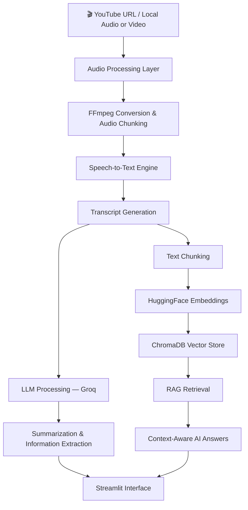

# 🎥 MeetMind AI — Your Meetings. Understood. Remembered. Actionable.

<p align="center">
  
  
  
  
  
</p>

<p align="center">
  <b>Turn long conversations into structured intelligence.</b><br/>
  Transcribe, understand, summarize, extract insights, and interact with your meetings using AI.
</p>

<p align="center">
  <a href="https://ai-video-meeting-assistant-rtqbwmgj4du4wnnn37wdzg.streamlit.app/">🚀 Live Application</a> •
  <a href="https://github.com/Ashijain30/AI-Video-Meeting-Assistant">💻 GitHub Repository</a>
</p>

---

## ⚡ The Problem

Meetings, lectures, interviews, webinars, and recorded discussions contain valuable information — but finding that information later is painful.

- Hours of recordings take too long to review.
- Important decisions get buried in conversations.
- Action items and key takeaways are easily missed.
- Searching through lengthy transcripts is inefficient.
- Rewatching an entire recording just to find one answer wastes time.

**MeetMind AI solves this by transforming unstructured audio and video into searchable, structured, AI-powered knowledge.**

## 🧠 What is MeetMind AI?

MeetMind AI is an AI-powered video and meeting intelligence platform that converts recordings into meaningful, actionable information.

It combines speech recognition, Large Language Models, NLP, semantic search, and Retrieval-Augmented Generation (RAG) into one workflow.

Instead of simply generating a transcript, MeetMind AI helps users understand what happened, what matters, and what needs to happen next.

## ✨ Core Features

| Feature | What it does |
|---|---|
| 🎬 YouTube Processing | Extracts audio from supported YouTube videos |
| 📁 Local Media Processing | Processes local audio/video files |
| 🎙️ Speech-to-Text | Generates transcripts using Whisper |
| 🌐 Multilingual Support | Supports an English transcription path and a Hinglish transcription path |
| 📝 AI Summarization | Converts lengthy conversations into concise summaries |
| 🔍 Key Information Extraction | Identifies important points and relevant information |
| 🧠 Semantic Search | Retrieves contextually relevant information from transcripts |
| 💬 AI Question Answering | Lets users ask questions about processed content |
| 📄 Export | Supports PDF and text-based output |

## 🏗️ System Architecture



## ⚙️ How It Works

### 1. Media Acquisition
Users provide a YouTube URL or upload a local audio/video file.

- `yt-dlp` handles supported YouTube media extraction.
- FFmpeg handles media conversion.
- Pydub helps normalize and split audio into manageable chunks.

### 2. Speech Recognition

The audio is processed through the transcription layer.

- **OpenAI Whisper:** Local speech recognition for English transcription.
- **Sarvam AI:** API-based transcription path for Hinglish content.

The resulting transcript becomes the foundation for downstream AI processing.

### 3. Intelligent Summarization

The transcript is passed to an LLM-powered processing layer using Groq and LangChain.

The system generates concise summaries and extracts useful information from lengthy conversations.

### 4. Retrieval-Augmented Generation

MeetMind AI also implements a RAG pipeline.

1. Transcript text is divided into smaller chunks.
2. HuggingFace embedding models convert text into vector representations.
3. ChromaDB stores the vector embeddings.
4. User queries retrieve semantically relevant chunks.
5. Retrieved context is used to generate more grounded answers.

This allows users to interact with their recordings instead of manually searching through transcripts.

### 5. Results & Interaction

The processed information is presented through a Streamlit interface, bringing transcription, summarization, extraction, and conversational retrieval together.

## 🛠️ Technology Stack

| Layer | Technologies |
|---|---|
| Programming Language | Python 3.12 |
| Frontend / Interface | Streamlit |
| Speech Recognition | OpenAI Whisper, Sarvam AI |
| LLM Inference | Groq |
| LLM Orchestration | LangChain |
| Embeddings | HuggingFace |
| Vector Database | ChromaDB |
| Audio Processing | FFmpeg, Pydub |
| Video Acquisition | yt-dlp |
| Document Export | ReportLab, FPDF2 |
| Environment Management | Python venv, python-dotenv |

## 🚀 Getting Started

### Prerequisites

- Python 3.12
- Git
- FFmpeg
- Required API credentials for the configured AI services

### 1. Clone the Repository

```bash
git clone https://github.com/Ashijain30/AI-Video-Meeting-Assistant.git

cd AI-Video-Meeting-Assistant
```

### 2. Create a Virtual Environment

**Windows:**

```powershell
python -m venv .venv
.venv\Scripts\activate
```

**macOS / Linux:**

```bash
python3 -m venv .venv
source .venv/bin/activate
```

### 3. Install Dependencies

```bash
pip install --upgrade pip
pip install -r requirements.txt
```

### 4. Configure Environment Variables

Create a `.env` file in the project root and add the API credentials required by your configuration.

```env
GROQ_API_KEY=your_groq_api_key
SARVAM_API_KEY=your_sarvam_api_key
```

Use the exact variable names expected by your application modules. Never commit real API keys to GitHub.

### 5. Install FFmpeg

Download FFmpeg from:

https://ffmpeg.org/download.html

Make sure FFmpeg and FFprobe are accessible through your system PATH, or configure the local FFmpeg binaries as supported by the audio-processing module.

### 6. Run the Application

```bash
streamlit run app.py
```

Open the local Streamlit URL displayed in your terminal.

## 📂 Project Structure

```text
AI-Video-Meeting-Assistant/
│
├── app.py
├── main.py
├── requirements.txt
├── packages.txt
│
├── core/
│   ├── transcriber.py
│   ├── summarizer.py
│   ├── extractor.py
│   ├── rag_engine.py
│   └── vector_store.py
│
├── utils/
│   └── audio_processor.py
│
├── downloads/
│
└── .env
```

*The structure above highlights the main application modules; additional files and configuration may exist in the repository.*

## 🌍 Deployment

The application is configured for deployment using **Streamlit Community Cloud**.

Deployment considerations include:

- Python 3.12 runtime compatibility.
- FFmpeg system dependencies.
- Cloud-compatible audio-processing configuration.
- API credentials managed through Streamlit secrets.
- JavaScript runtime configuration for yt-dlp YouTube extraction.

**Live Demo:**  
https://ai-video-meeting-assistant-rtqbwmgj4du4wnnn37wdzg.streamlit.app/

*YouTube availability may depend on source-video restrictions and the hosting environment.*

## 🔮 Future Roadmap

MeetMind AI is designed to evolve beyond basic meeting transcription.

- [ ] Speaker identification and diarization.
- [ ] Timestamp-based transcript navigation.
- [ ] Meeting action-item and decision tracking.
- [ ] Automatic meeting minutes generation.
- [ ] Advanced multilingual transcription.
- [ ] Persistent knowledge bases across meetings.
- [ ] Meeting comparison and cross-meeting insights.
- [ ] Improved processing for long recordings.
- [ ] Calendar and meeting-platform integrations.

## 💡 Why This Project?

This project explores how multiple AI components can work together in a practical application.

It brings together:

- Speech-to-Text systems.
- Large Language Models.
- Prompt orchestration.
- Text chunking and embeddings.
- Vector databases.
- Retrieval-Augmented Generation.
- Media processing pipelines.
- Cloud deployment.

The goal is simple: **make recorded conversations useful long after the meeting ends.**

## 👨‍💻 Author

**Ashijain30**

AI/ML Developer | Building practical AI-powered applications.

- GitHub: https://github.com/Ashijain30
- Project: https://github.com/Ashijain30/AI-Video-Meeting-Assistant

---

<p align="center">
  <b>Don't just record conversations. Understand them.</b>
  <br/>
  Made with ❤️ and a lot of Python.
</p>
